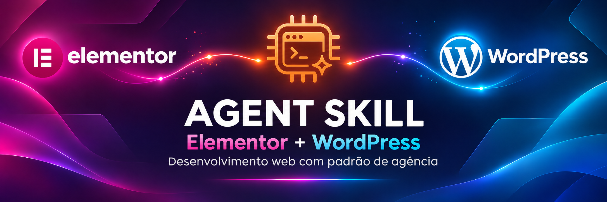

<p align="center">
  
</p>

# Skill Elementor + WordPress para Claude, Codex e outros agentes

Uma skill que ensina a IA (**Claude Code, Codex** ou qualquer agente que leia `SKILL.md`) a trabalhar em sites **WordPress feitos com Elementor / Elementor Pro** no padrão de uma agência: páginas refeitas com containers e **widgets oficiais**, header e rodapé no **Theme Builder**, **design system** no Kit do Elementor, **SEO com Rank Math**, **acessibilidade 100** no Lighthouse, imagens otimizadas em **WebP**, **animações** de entrada leves e **limpeza** segura do site.

Ela nasceu de um projeto real e guarda tanto o fluxo de trabalho quanto as armadilhas que só aparecem na prática: popup que perde as configurações ao salvar, cache de elementos que quebra animações, Wordfence bloqueando senha de aplicativo, Rank Math vendo "0 palavras" em páginas do Elementor, entre outras.

> *English: a universal agent skill (Claude Code + Codex) for building and maintaining Elementor/WordPress sites to an agency standard. Download `elementor-wordpress.skill` from Releases and upload it in Claude → Settings → Skills.*

---

## Como instalar

Há dois caminhos: **deixar a própria IA instalar** (mais fácil) ou fazer **manualmente**.

### Opção A: peça para a IA configurar

Abra o Claude Code ou o Codex em qualquer pasta e cole o prompt abaixo. Ele instala a skill, confere o que falta no computador e testa a conexão com o site.

```text
Instale e configure a skill "elementor-wordpress" para mim.

1. Baixe o repositório https://github.com/davirlima/elementor-wordpress-skill
   (git clone, ou o .zip da última Release).
2. Copie a pasta para o diretório de skills do agente em que você está rodando:
   - Claude Code: ~/.claude/skills/elementor-wordpress/
   - Codex: ~/.codex/skills/elementor-wordpress/ (ou ~/.agents/skills/elementor-wordpress/)
   Se for possível instalar para os dois, instale nos dois. Confirme que SKILL.md ficou na raiz da pasta.
3. Confira as dependências (python3, node, curl, Chromium) e me diga o que faltar e como instalar.
4. Meu site é: https://SEU-SITE.com.br
   O Elementor MCP DESTE site é obrigatório. Rode python3 scripts/env_from_mcp.py --list e depois
   eval "$(python3 scripts/env_from_mcp.py)" e python3 scripts/doctor.py.
   - Se o MCP deste site ainda não estiver conectado, me guie e não siga sem ele: em wp-admin,
     Elementor -> Elementor MCP -> Enable MCP access -> aba do seu agente -> Generate Prompt ->
     Copy prompt, que eu colo aqui. Aplique a conexão sem repetir a senha em nenhuma resposta.
   - Requisitos: Elementor e Elementor Pro 4.3.0+, WordPress 6.8+. Se for mais antigo, me avise antes de atualizar.
5. Leia references/elementor-mcp-docs.md e references/wordpress-rest-docs.md e me confirme a versão do
   Elementor e do WordPress do site.
6. Se o doctor.py acusar bloqueio de rede (sandbox), NÃO diga que não consegue acessar a API:
   peça a permissão de rede/aprovação necessária ou me diga o ajuste exato a fazer.
7. No fim, me diga em uma linha o que ficou pronto e peça para eu reiniciar o agente.
```

Troque `https://SEU-SITE.com.br` pelo endereço do cliente. Se você ainda não tem a conexão com o site, pode apagar a parte do endereço: a IA vai te guiar.

### Opção B: manual

**No Claude Code ou no Codex (qualquer computador):**

1. Baixe o **`elementor-wordpress.zip`** na página de **[Releases](https://github.com/davirlima/elementor-wordpress-skill/releases/latest)**, ou clone o repositório.
2. Coloque a pasta **`elementor-wordpress`** (com o `SKILL.md` na raiz dela) no diretório de skills:

   | Agente | macOS / Linux | Windows |
   |---|---|---|
   | Claude Code | `~/.claude/skills/` | `C:\Users\<você>\.claude\skills\` |
   | Codex | `~/.codex/skills/` (ou `~/.agents/skills/`) | `C:\Users\<você>\.codex\skills\` |

   Estrutura final: `.../skills/elementor-wordpress/SKILL.md`.
3. Abra o agente de novo.

**No Claude.ai (conta):**

1. Baixe o arquivo **`elementor-wordpress.skill`** em Releases.
2. Em **Configurações → Capacidades → Skills**, clique em **Enviar skill** e escolha o arquivo.
3. A skill passa a valer no Claude.ai e no Claude Code conectado à mesma conta. Se a organização não permitir, peça ao administrador.

---

## Como usar

Você não precisa chamar a skill pelo nome. Basta pedir algo sobre um site com Elementor, por exemplo:

- "Refaz a home desse cliente no padrão do Elementor, só com widgets oficiais."
- "Passa o header e o rodapé para o Theme Builder."
- "Organiza as cores e fontes do site no Kit do Elementor."
- "As páginas internas estão com nota baixa no Rank Math, o que está acontecendo?"
- "Otimiza as imagens da home para WebP com nomes bons para SEO."
- "Coloca animações de entrada sutis nas dobras."
- "Faz uma limpa nos rascunhos, modelos e mídias que não são usados."
- "Troca o WhatsApp de aluguel para este número em todo o site, rodapé e chat."

No início de cada projeto, a IA pergunta o que precisa: endereço do site, fontes e cores da marca, WhatsApp e mensagens de contato, e quais páginas entram no trabalho.

### Para a IA mexer no site

Para trabalhar direto no site, a IA precisa de acesso. O caminho mais simples:

Requisitos: **Elementor e Elementor Pro 4.3.0 ou superior**, **WordPress 6.8 ou superior** e site com HTTPS.

1. No WordPress, vá em **Elementor → Elementor MCP** e clique em **Enable MCP access**. O ideal é usar um usuário administrador só para isso.
2. Escolha a aba da sua IA (**Claude Code, Codex, Claude Desktop, Cursor** ou outra), marque a caixa de confirmação e clique em **Generate Prompt**, depois em **Copy prompt**. Ele traz o endereço, o usuário e uma senha de aplicativo criada na hora.
3. Cole esse prompt no Claude Code ou no Codex. A IA conecta o site para você e pede para reiniciar (no Claude Code, `/mcp`).
4. Se usar **Wordfence**, deixe as senhas de aplicativo permitidas para esse usuário.

A senha nunca é gravada na skill. A IA a lê das variáveis de ambiente da sua máquina ou, se elas não existirem, do conector que você já configurou no Claude Code ou no Codex (sem exibir a senha). O **Elementor MCP do site é obrigatório**: sem ele conectado, a IA não começa o trabalho; ela te pede o prompt de conexão e diz exatamente onde pegá-lo. A API REST do WordPress complementa o MCP no que ele não alcança. Você não precisa exportar nada de novo.

**Se a IA disser que não consegue acessar a API do WordPress**, quase sempre é o *sandbox* bloqueando a rede, não uma limitação real. A skill traz o `scripts/doctor.py`, que testa DNS, HTTPS, login e Rank Math e diz a causa exata. No Codex, aprove a execução fora do sandbox ou ative `network_access = true` em `[sandbox_workspace_write]` no `~/.codex/config.toml`; no Claude Code, aprove o comando quando ele pedir.

**Documentação já lida:** a skill traz resumos das documentações do Elementor MCP, da API REST do WordPress e do Rank Math, cada um com versão e data de verificação e com a lista de páginas originais para reconferir (`references/*-docs.md`). A IA lê o resumo, compara a versão do site e só abre a fonte quando faz diferença, atualizando o resumo se algo mudou.

**Rank Math:** a skill traz um resumo da documentação do Rank Math, com versão e data de verificação, e diz qual página consultar para cada necessidade (`references/rankmath-docs.md`). Assim a IA já parte do essencial, confere a versão do plugin e só abre a doc original quando isso importa. O comando curto `wp.py rankmath <id> --title --description --keyword` grava o SEO de uma página.

**Ao terminar o projeto**, peça "desconecta o site e apaga as credenciais". A IA remove o conector, apaga as senhas guardadas no histórico local e lembra você de **revogar a senha de aplicativo no WordPress** (Usuários → Perfil → Senhas de aplicativo), que é o que realmente invalida o acesso.

---

## O que a skill garante em cada entrega

- Só componentes oficiais do Elementor, do Elementor Pro e do WordPress.
- Containers, tokens globais do Kit, um H1 por página e títulos pensados para SEO.
- Backup antes de qualquer alteração e ações reversíveis: página antiga vira rascunho e o que é removido vai para a lixeira. Mídia só é apagada depois de um backup local.
- Conferência no site publicado, no desktop e no celular, com prints e Lighthouse. Quando a mudança não deveria alterar o visual, comparação pixel a pixel.
- Relatório claro do que mudou, do que foi testado e do que ficou para você fazer.

---

## O que vem no pacote

| Pasta | Conteúdo |
|---|---|
| `SKILL.md`, `AGENTS.md`, `agents/` | Padrão de qualidade, regras de segurança, fluxo de trabalho e definição de "pronto" |
| `references/` | Guias de consulta e resumos das documentações (Elementor MCP, WordPress REST, Rank Math): conexão, armadilhas conhecidas, estrutura do Elementor, design system, padrões de página, SEO, acessibilidade, mídia, animações, limpeza |
| `scripts/` | Ferramentas que a IA usa: teste de conexão (`doctor.py`), cliente do WordPress, kit de componentes, aplicação de tokens, animações, texto para o Rank Math, auditoria de mídia, prints, comparação de imagens, checagens de página, conversão para WebP e Lighthouse |
| `evals/` | Casos de teste usados para validar a skill |

Para usar as ferramentas de navegador (prints, Lighthouse, WebP), o computador precisa ter Python, Node.js e o navegador Chromium. Se faltar algo, a IA avisa e explica como resolver.

---

## Licença

MIT. Use, adapte e compartilhe à vontade.
